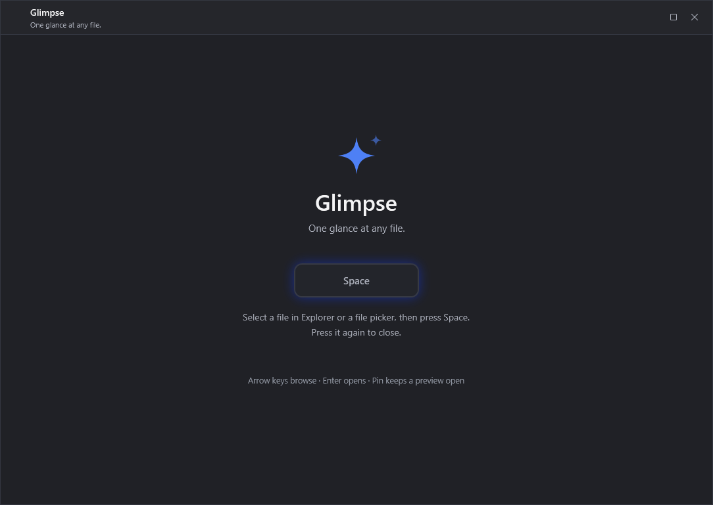
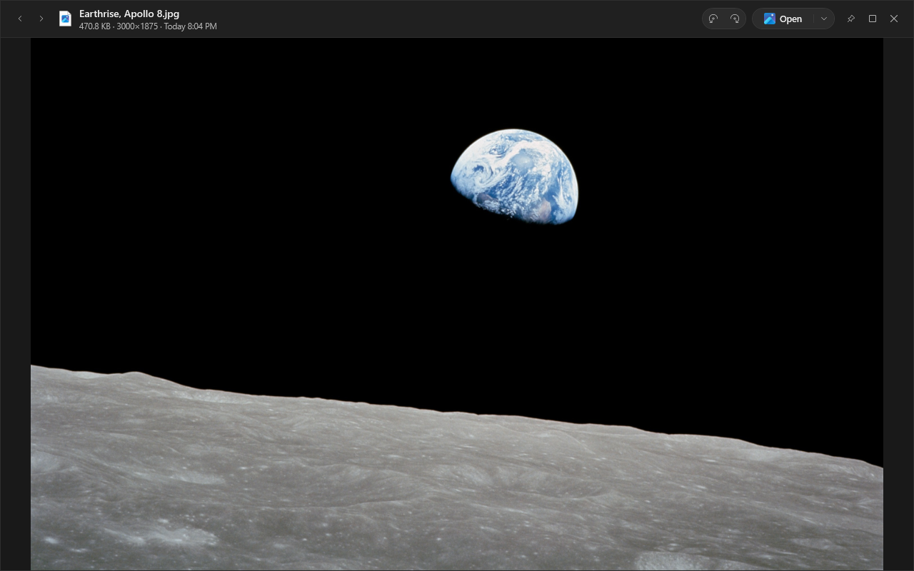
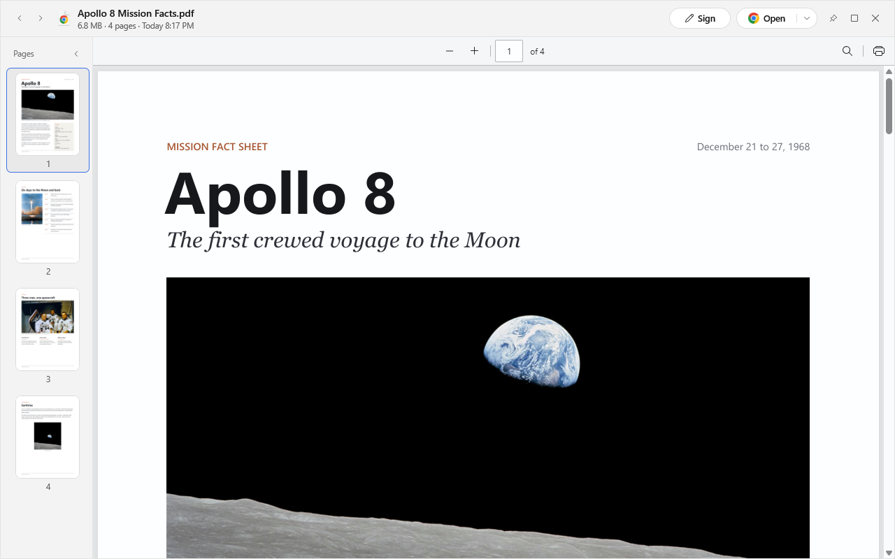
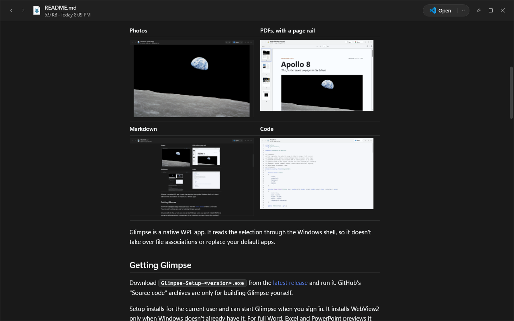
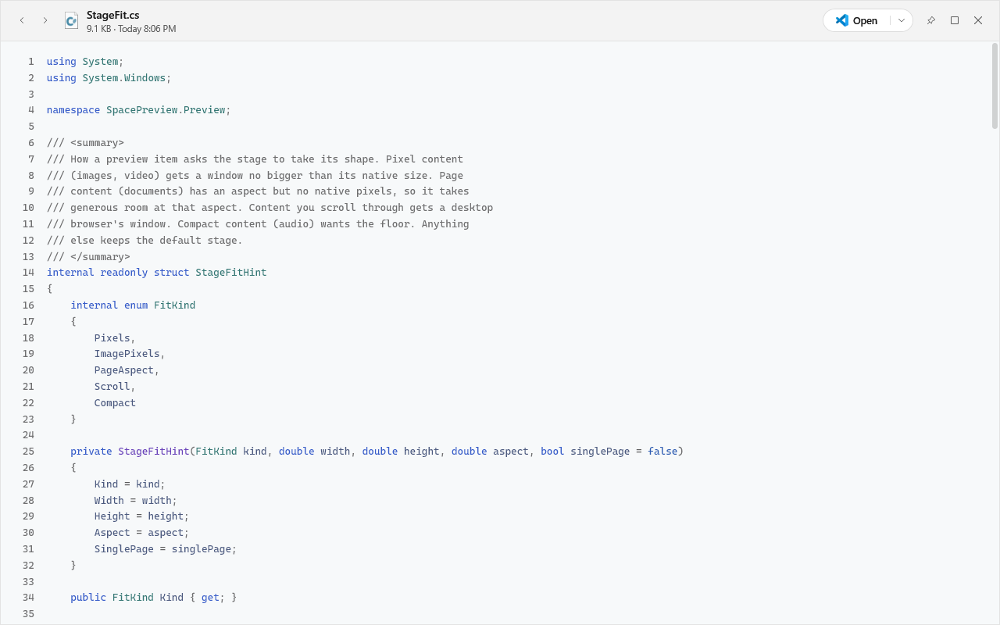

# Glimpse

Glimpse is Quick Look for Windows. Select a file in File Explorer, on the desktop or in an Open or upload dialog, press Space, and Glimpse shows it. Press Space or Esc to close it.



| Photos | PDFs, with a page rail |
|---|---|
|  |  |
| **Markdown** | **Code** |
|  |  |

Glimpse is a native WPF app. It reads the selection through the Windows shell, so it doesn't take over file associations or replace your default apps.

## Getting Glimpse

Download `Glimpse-Setup-<version>.exe` from the [latest release](https://github.com/tekkusai/Glimpse/releases/latest) and run it. GitHub's "Source code" archives are only for building Glimpse yourself.

Setup installs for the current user and can start Glimpse when you sign in. It installs WebView2 only when Windows doesn't already have it. For full Word, Excel and PowerPoint previews it can also add LibreOffice, and it shows the size of that download before anything happens.

After that, Glimpse keeps itself up to date. It installs a new release while you're away from your PC, never while a preview is open or a game or presentation is full screen, and only when the release is signed by its developer. Settings has a switch to turn this off and an Install now button.

## What it shows

- Photos and images, including HEIC, WebP, AVIF, SVG and Photoshop files. Images zoom around the cursor, and Ctrl+R turns a photo and saves the turn.
- PDFs and Illustrator files in the WebView2 PDF viewer, with a page rail beside them.
- Word, Excel and PowerPoint files through LibreOffice or OpenOffice. A big deck shows its first slides in a few seconds while the rest converts. Without either engine, Glimpse shows the text.
- Markdown, code with syntax colors, JSON, logs and plain text.
- Your own web pages, with scripts off and nothing loaded from the internet.
- Video and audio, with the track's cover and tags.
- Folders and archives as a list of what's inside, largest first.
- Fonts as a full specimen in their own face.
- 3D models (STL, OBJ, PLY, 3MF, GLB) as solid shapes you can turn, and STEP files as a wireframe.
- EPUB books, programs, shortcuts and app packages.

Each kind opens in a window shaped for it. Photos, video and pages take their own shape. Anything you scroll through opens at the size of a desktop browser window. Everything else opens in a compact window.

## Using it

| Key | What it does |
|---|---|
| Space, Esc | Close the preview |
| Arrow keys | The next or previous file in the folder |
| Enter | Open the file in its app |
| Ctrl+Plus, Ctrl+Minus, Ctrl+0 | Zoom in, out, and back to fit |
| Ctrl+R, Ctrl+Shift+R | Turn an image right or left |
| F11 | Fill the screen |

Select several files before pressing Space and the arrows step through only those. The grid button shows them all at once, and a slideshow plays them.

The pin keeps a preview open while you go on browsing, up to six at a time. Right-click a preview to copy its text, the file or its path, and use the menu beside Open for Open with, Show in Explorer and Share.

**Fill & Sign.** A PDF's Sign button lets you place a signature, a date or a stamp on any page, then save a signed copy beside the original or sign it in place. Signatures you draw are saved for next time. If Glimpse closes before you save, Sign reads Resume the next time you open that PDF.

## Requirements

- Windows 10 1809 or newer on x64. ARM64 works through Windows' x64 emulation.
- WebView2 Runtime, which Setup installs when it's missing.
- Optional: LibreOffice or OpenOffice for full Office previews.
- To build from source: the .NET 10 SDK, and Inno Setup 6 for the installer.

## Building from source

```powershell
git clone https://github.com/tekkusai/Glimpse.git
cd Glimpse
dotnet build .\SpacePreview.sln -c Release
```

The build lands at `.\SpacePreview\bin\Release\net10.0-windows10.0.17763.0\Glimpse.exe`, and you can run it directly.

## Tests

```powershell
dotnet test .\SpacePreview.sln -c Release
.\SpacePreview\scripts\regression.ps1
.\SpacePreview\scripts\smoke.ps1
```

The regression suite renders previews off screen in a throwaway data folder. The smoke test drives File Explorer for real and expects Glimpse to be running already.

## Publishing

```powershell
.\SpacePreview\scripts\build-installer.ps1
```

This publishes a self-contained build, packages it with Inno Setup, and signs the checksum with the release key. [docs/RELEASE.md](docs/RELEASE.md) has the full checklist, and [docs/DESIGN.md](docs/DESIGN.md) has the rules for how Glimpse looks and moves.

## Startup commands

```powershell
Glimpse.exe --install-startup     # start when you sign in
Glimpse.exe --uninstall-startup   # stop starting when you sign in
Glimpse.exe --quit                # quit the running copy
```

## Security and privacy

Glimpse reads a file only when you ask to preview it. Files never leave your PC, and Glimpse doesn't change their default apps. The only request Glimpse makes on its own is to GitHub, to look for a new release.

The Space shortcut uses a low-level keyboard hook, installed only while File Explorer, the desktop, a file dialog or Glimpse itself is in front. Office conversion runs with its network blocked. Updates install only when their signature matches the key built into the app. Diagnostic logs stay in `%LOCALAPPDATA%\Glimpse`, rotate by size, and hide file paths.

Please use the process in [SECURITY.md](SECURITY.md) to report a vulnerability.

## License

Glimpse is available under the [MIT License](LICENSE). The photographs in the screenshots are NASA's, from Apollo 8 in 1968, and are in the public domain.
