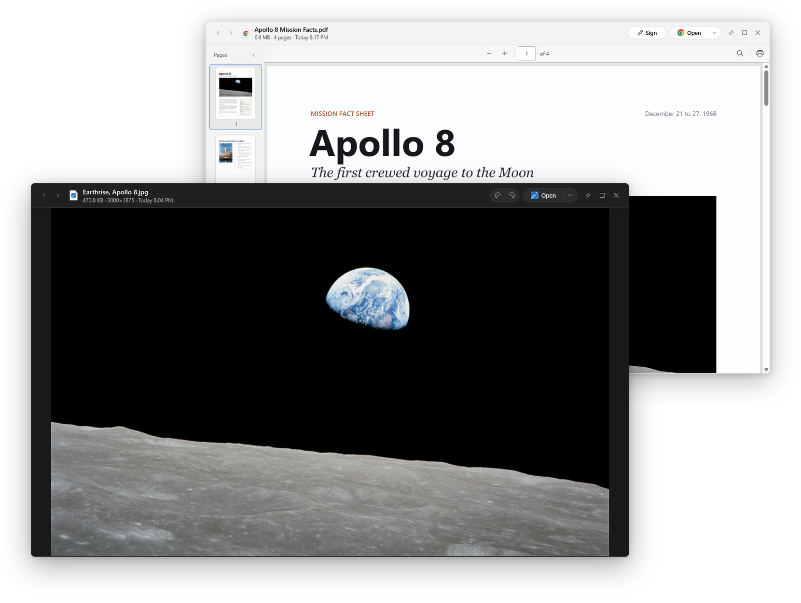
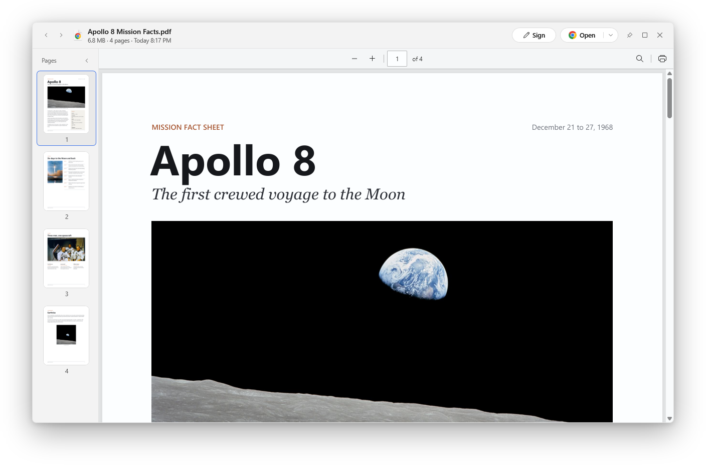
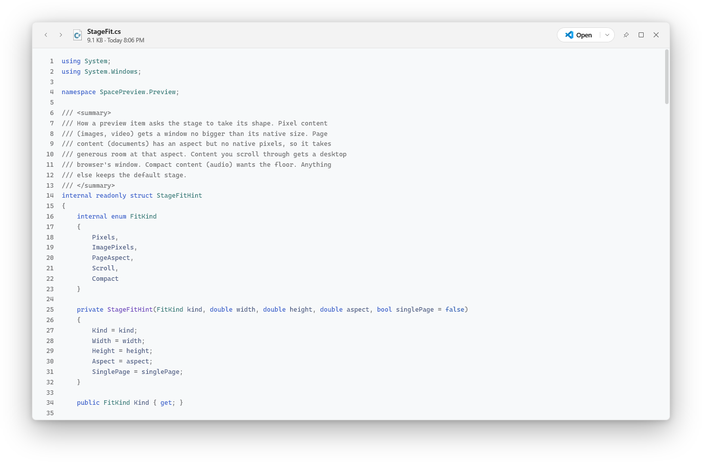

<p align="center">
  <picture>
    <source media="(prefers-color-scheme: dark)" srcset="docs/readme/title-dark.png">
    
  </picture>
</p>

<h3 align="center">One glance at any file.</h3>

<p align="center">
  Click a file and press <kbd>Space</kbd>. There it is.<br>
  Press <kbd>Space</kbd> again and it's gone.
</p>

<p align="center">
  <a href="https://github.com/tekkusai/Glimpse/releases/download/v3.0.3/Glimpse-Setup-3.0.3.exe"></a>
</p>

<p align="center"><sub>Free · Windows 10 and 11 · <a href="https://github.com/tekkusai/Glimpse/releases/latest">What's new in 3.0.3</a></sub></p>

<p align="center">
  
</p>

<h2 align="center">See a file before you open it</h2>

<p align="center">
  You know the file is in this folder. You don't know which one it is.<br>
  Click the first, press Space, and walk down the list with the arrow keys.<br>
  Each file shows as you reach it, and Enter opens the one you want.
</p>

<p align="center">
  It works in File Explorer, on the desktop, and in the window<br>
  where you pick a file to attach to an email or upload to a website.<br>
  On a Mac this is called Quick Look. Glimpse brings it to Windows.
</p>

<h2 align="center">It opens almost anything</h2>

<p align="center">
  <b>Photos</b> · <b>PDFs</b> · <b>Word, Excel and PowerPoint</b> · <b>Videos and music</b><br>
  <b>Folders and zip files</b> · <b>Code and notes</b> · <b>Fonts</b> · <b>3D models</b> · <b>E-books</b> · <b>Web pages</b>
</p>

<p align="center">
  No Microsoft Office needed. Every kind gets a window shaped for it.<br>
  The <a href="#everything-it-opens">full list</a> is further down.
</p>

<h2 align="center">Sign a PDF and send it back</h2>

<p align="center">
  A form arrives by email. Press Space on it and choose Sign.<br>
  Place your signature, a date or a stamp, and save a signed copy next to the original.<br>
  You print nothing and you scan nothing.
</p>

<p align="center">
  
</p>

<h2 align="center">Keep a file in view</h2>

<p align="center">
  Pin a preview and it stays open while you go on browsing.<br>
  Keep an invoice beside the spreadsheet you're filling in, or line up six photos to compare.
</p>

<h2 align="center">Read code without opening an editor</h2>

<p align="center">
  Code opens in color with line numbers.<br>
  A Markdown file opens as the page it describes.
</p>

<p align="center">
  
</p>

<h2 align="center">Quiet and private</h2>

<p align="center">
  Your files never leave your PC.<br>
  Your default apps stay as they are.<br>
  Glimpse listens for Space only while File Explorer, the desktop or a file window is in front.<br>
  It updates itself while you're away, and only with a release signed by its developer.
</p>

<h2 align="center">Get Glimpse</h2>

<p align="center">
  <a href="https://github.com/tekkusai/Glimpse/releases/download/v3.0.3/Glimpse-Setup-3.0.3.exe"></a>
</p>

<p align="center">
  <b>1.</b> Download it. &nbsp;&nbsp; <b>2.</b> Open the file you downloaded. &nbsp;&nbsp; <b>3.</b> Click any file and press Space.
</p>

<p align="center">
  Your browser and Windows may ask if you're sure, because the installer isn't code-signed yet.<br>
  In the blue "Windows protected your PC" box, choose More info, then Run anyway.
</p>

<p align="center">
  Setup doesn't need administrator rights. It asks whether Glimpse should start when you sign in,<br>
  and whether to add LibreOffice for Word, Excel and PowerPoint, with the size of that download shown first.<br>
  After that, Glimpse keeps itself up to date.
</p>

<br>

## Keys

| Key | What it does |
|---|---|
| <kbd>Space</kbd> or <kbd>Esc</kbd> | Close the preview |
| Arrow keys | The next or previous file in the folder |
| <kbd>Enter</kbd> | Open the file in its app |
| <kbd>Ctrl</kbd> <kbd>+</kbd>, <kbd>Ctrl</kbd> <kbd>-</kbd>, <kbd>Ctrl</kbd> <kbd>0</kbd> | Zoom in, out, and back to fit |
| <kbd>Ctrl</kbd> <kbd>R</kbd>, <kbd>Ctrl</kbd> <kbd>Shift</kbd> <kbd>R</kbd> | Turn an image right or left |
| <kbd>Home</kbd>, <kbd>End</kbd> | The first or the last line of a text file |
| <kbd>F11</kbd> | Fill the screen |

Select several files before you press Space and the arrow keys step through only those. The grid shows them all at once, and a slideshow plays them. Right-click a preview to copy its text, the file or its path. On a photo you can select words right in the picture and copy them, and Copy text takes all of them. The reading happens on your PC, in the languages your Windows has. The menu beside Open has Open with, Show in Explorer and Share.

## Everything it opens

- **Photos and images.** JPEG, PNG, HEIC, WebP, AVIF, SVG and Photoshop files (PSD and PSB). Images zoom around the cursor, and Ctrl+R turns a photo and saves the turn.
- **Camera RAW.** Sony, Canon, Nikon, Fujifilm, DNG and other RAW files, through Windows' Raw Image Extension, which Glimpse offers when it is missing. A RAW file is never changed.
- **PDFs and Illustrator files.** In the WebView2 PDF viewer, with a page rail beside them.
- **Word, Excel and PowerPoint.** Through LibreOffice or OpenOffice. A big deck shows its first slides in a few seconds while the rest converts. Without either engine, Glimpse shows the text.
- **Text.** Markdown, code with syntax colors, JSON, logs and plain text. A log of any size opens on its first lines and reads on as you scroll, and End goes to its last line.
- **Web pages.** Your own saved pages, with scripts off and nothing loaded from the internet.
- **Video and audio.** With the track's cover and tags.
- **Folders and archives.** A list of what's inside, largest first.
- **Fonts.** A full specimen in the font's own face.
- **3D models.** STL, OBJ, PLY, 3MF and GLB as solid shapes you can turn, and STEP files as a wireframe.
- **More.** EPUB books, programs, shortcuts and app packages.

Photos, video and pages take their own shape. Anything you scroll through opens at the size of a desktop browser window. Everything else opens in a compact window.

## Privacy and security

Glimpse reads a file only when you ask to preview it. Files never leave your PC, and Glimpse doesn't change their default apps. The only request Glimpse makes on its own is to GitHub, to look for a new release.

The Space shortcut uses a low-level keyboard hook, installed only while File Explorer, the desktop, a file dialog or Glimpse itself is in front. Before a document is converted, Glimpse removes links that point outside the file from modern Office and OpenDocument files, and the converter's web access is blocked. Old-format Office files (`.doc`, `.xls`, `.ppt`, `.rtf`) can't be cleaned that way yet: one that links a picture from a shared folder can make the converter contact that folder when the file is previewed.

Updates install while you're away from your PC, never while a preview is open or a game or presentation is full screen, and only when their signature matches the key built into the app. Settings has a switch to turn this off and an Install now button. Diagnostic logs stay in `%LOCALAPPDATA%\Glimpse`, rotate by size, and hide file paths.

A file on a phone or inside a zip folder has no place on disk. To show one, Glimpse copies it into its own folder, read-only. It gives a copy 20 seconds to arrive, keeps the newest four and any that a window is still showing, and removes them all the next time it starts.

Please use the process in [SECURITY.md](SECURITY.md) to report a vulnerability.

## Requirements

- Windows 10 1809 or newer on x64. ARM64 works through Windows' x64 emulation.
- WebView2 Runtime, which Setup installs when it's missing.
- Optional: LibreOffice or OpenOffice for full Office previews.

## Build from source

You need the .NET 10 SDK, and Inno Setup 6 for the installer. GitHub's "Source code" archives are only for this.

```powershell
git clone https://github.com/tekkusai/Glimpse.git
cd Glimpse
dotnet build .\SpacePreview.sln -c Release
dotnet test .\SpacePreview.sln -c Release
```

The build lands at `.\SpacePreview\bin\Release\net10.0-windows10.0.17763.0\Glimpse.exe`, and you can run it directly.

```powershell
.\SpacePreview\scripts\regression.ps1       # renders previews off screen in a throwaway data folder
.\SpacePreview\scripts\smoke.ps1            # drives File Explorer for real, with Glimpse already running
.\SpacePreview\scripts\build-installer.ps1  # publishes, packages with Inno Setup, signs the checksum
```

[docs/RELEASE.md](docs/RELEASE.md) has the full release checklist, and [docs/DESIGN.md](docs/DESIGN.md) has the rules for how Glimpse looks and moves.

The installed app takes three commands:

```powershell
Glimpse.exe --install-startup     # start when you sign in
Glimpse.exe --uninstall-startup   # stop starting when you sign in
Glimpse.exe --quit                # quit the running copy
```

## License

Glimpse is available under the [MIT License](LICENSE). The photographs in the screenshots are NASA's, from Apollo 8 in 1968, and are in the public domain.
